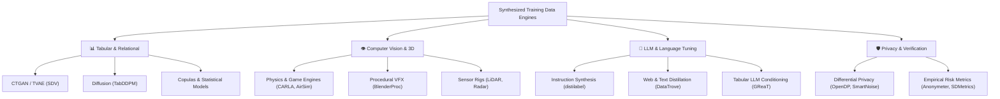

  

  
  
  
  
  
  
  

---

# 🚀 Awesome Synthesized Training Data Engines

> **A curated collection of state-of-the-art SaaS platforms, open-source libraries, differential privacy frameworks, and simulation engines for generating high-fidelity artificial training data.**

Welcome to the definitive index of **Synthesized Training Data Engines**! As machine learning models, autonomous perception pipelines, and Large Language Models (LLMs) reach the boundaries of available human-generated data, **synthetic data engines** have emerged as foundational AI infrastructure. These systems synthesize high-fidelity artificial data that strictly mimics the statistical distribution, correlations, and edge cases of real-world datasets while providing rigorous mathematical privacy guarantees (such as Differential Privacy), preventing data leakage, and resolving regulatory roadblocks (GDPR, CCPA, HIPAA, EU AI Act).

---

## 📑 Table of Contents

- [🌟 Why Synthesized Training Data Matters](#-why-synthesized-training-data-matters)
- [📈 Sector Overview & Market Dynamics](#-sector-overview--market-dynamics)
- [🏢 SaaS & Hosted Enterprise Platforms](#-saas--hosted-enterprise-platforms)
- [💻 Open-Source Frameworks & Libraries](#-open-source-frameworks--libraries)
  - [Top Tier (10,000+ ⭐ Stars)](#top-tier-10000--stars)
  - [High-Growth & Enterprise Grade (1,000+ ⭐ Stars)](#high-growth--enterprise-grade-1000--stars)
  - [Specialized & Research Grade (< 1,000 ⭐ Stars)](#specialized--research-grade--1000--stars)
- [🧩 Key Modalities & Engine Taxonomies](#-key-modalities--engine-taxonomies)
- [🛠️ Recommended Self-Hosted Stack](#️-recommended-self-hosted-stack)
- [🤝 How to Contribute](#-how-to-contribute)
- [⭐ Star History](#-star-history)
- [💖 Support & Community](#-support--community)
- [📄 License & Disclaimer](#-license--disclaimer)

---

## 🌟 Why Synthesized Training Data Matters

1. **🛡️ Absolute Privacy & Compliance**: Facilitate data democratization, third-party collaboration, and cross-border machine learning without exposing sensitive Personal Identifiable Information (PII) or protected health information (PHI).
2. **🎯 Rare Event & Edge Case Amplification**: Simulate rare scenarios (e.g., self-driving edge collisions, rare disease medical scans, zero-day fraud signatures) that occur with low frequency in organic logs.
3. **⚖️ Algorithmic De-Biasing & Fairness**: Rebalance skewed class distributions and augment underrepresented demographic classes to create fair, ethical, and representative AI models.
4. **💰 Cost-Effective Model Pretraining & Distillation**: Avoid multimillion-dollar manual data collection, annotation contracts, and per-token proprietary API rate limits.

---

## 📈 Sector Overview & Market Dynamics

The global **synthesized training data market** is valued at approximately **$710M – $804M in 2026** and is accelerating at an extraordinary **31% to 38.9% CAGR**, projected to eclipse **$3B to $6B+ by 2031** as frontier AI models exhaust human-created data and privacy regulations (GDPR, CCPA, HIPAA) intensify. 

The sector remains **moderately fragmented** rather than a winner-take-all monopoly: high domain specialization divides leaders across distinct modalities (tabular/relational enterprise data, photorealistic 3D computer vision, autonomous vehicle simulation, and LLM alignment), while major tech conglomerates actively acquire specialized trailblazers (e.g., NVIDIA acquiring Gretel.ai, SAS acquiring Hazy, KPMG acquiring YData) to anchor their core AI infrastructure stacks.

---

## 🏢 SaaS & Hosted Enterprise Platforms

The table below catalogs leading commercial and hosted platforms for synthetic data fabrication, ranked by **Company Size / Estimated Valuation (descending)**. Every platform includes verified starting tier pricing and specific free tier or trial limitations.

| Platform / Company 🌐 | Company Size / Valuation 🏢 | Pricing (Starting Tier) 💳 | Free Tier / Trial Limits ⏱️ | Key Capabilities & Modalities 🎯 |
| :--- | :--- | :--- | :--- | :--- |
| **[Gretel.ai](https://gretel.ai/)** | **~$335M Valuation** (Acquired by NVIDIA; $67.7M venture funding) | **$295/month** (Team Plan base; includes credits + $2/additional credit) | **Free forever plan**: 15 credits/month, 2 concurrent jobs, max 1 hour runtime | Tabular, text, and time-series data; built-in differential privacy, fidelity & memorization scoring |
| **[Datagen](https://datagen.com/)** | **~$275M Valuation** ($70M funding raised; $50M Series B) | **$1,500/month** (Data Generation Units entry plan; ~$1.50/rendered DGU) | **14-day free trial**: Enterprise sandbox with 50 high-resolution photorealistic 3D human/sensor scene renders | Photorealistic 3D human & computer vision simulation; facial dynamics, gaze estimation, IoT perception |
| **[Tonic.ai](https://www.tonic.ai/)** | **~$175M Valuation** ($45M funding raised; $35M Series B) | **$29/month** (Tonic Fabricate Plus plan; includes $25/mo usage credits) | **Free forever plan**: $5–$10 monthly AI generation credits (Fabricate); up to 100k words free (Textual) | Developer-centric database synthesis, relational integrity preservation, PII masking & text redaction |
| **[Parallel Domain](https://paralleldomain.com/)** | **~$120M Valuation** ($44.3M funding raised; $30M Series B) | **$2,000/month** (DataLab Developer API initial tier) | **14-day free trial**: Sandbox access to PD Replica Sim environment with 10 pre-configured sensor rigs | Synthetic sensor data (LiDAR, radar, RGB) and procedural city environments for autonomous driving & robotics |
| **[Mostly AI](https://mostly.ai/)** | **~$110M Valuation** ($31.1M funding raised; $25M Series B) | **$48/month** (Pro Creator tier; $0.001/credit overage) | **Free forever plan**: 5 credits/day (up to 100,000 synthetic rows per daily job execution) | Enterprise tabular and multi-table relational data synthesis with automated mathematical differential privacy |
| **[Synthesis AI](https://synthesis.ai/)** | **~$85M Valuation** ($25.4M funding raised; $17M Series A) | **$500/month** (HumanAPI / FaceAPI starter tier; ~$0.25/annotated image) | **14-day free trial**: Developer sandbox trial with 250 free photorealistic biometric/facial sample renders | Generative AI + cinematic VFX pipelines producing pixel-perfect labeled image and video datasets for CV models |
| **[Synthetaic](https://synthetaic.com/)** | **~$60M Valuation** ($33M funding raised; $15M Series B) | **$1,250/month** (RAIC Explorer entry tier for satellite & drone analysis) | **14-day free trial**: Guided POC trial with processing of up to 1,000 geospatial frames / 10 sq km tile area | Rapid Automatic Image Categorization (RAIC) without human pre-labeling for aerial, satellite, and EO sensors |
| **[Hazy](https://hazy.com/)** | **~$35M Valuation** ($14.8M funding; Acquired by SAS in Nov 2024) | **$1,000/month** (SAS Data Maker / Hazy synthetic data module subscription) | **30-day free trial**: Enterprise POC trial via SAS Viya / AWS Marketplace (up to 50,000 synthetic records) | Secure synthetic data pipelines with formal privacy guarantees for banking, insurance, and fraud detection |
| **[Mindtech](https://mindtech.ai/)** | **~$30M Valuation** (£11.8M / ~$15M total funding; £4.4M round in Oct 2024) | **$800/month** (Chameleon Studio starter pack) | **14-day free trial**: Chameleon evaluation sandbox with 1 smart environment pack & 100 scene variations | Chameleon platform simulating complex 3D human-centric environments, edge cases, and behavior for visual AI |
| **[YData](https://ydata.ai/)** | **~$20M Valuation** ($3M funding; Acquired by KPMG US in 2024) | **$1.00/credit** (Fabric pay-as-you-go; ~$1 per 1M data points or 10k tokens) | **Free forever plan**: Community Plan with recurring monthly credits, 20+ connectors & automated profiling | Data-centric AI platform & SDK for tabular data profiling, quality benchmarking, and synthetic augmentation |

---

## 💻 Open-Source Frameworks & Libraries

All repositories below are equipped with live social Stars_Badges and are sorted strictly in **descending order of GitHub Stars_Count**. Click on any Stars_Badge to inspect the repository's stargazers.

### Top Tier (10,000+ ⭐ Stars)

- **[faker](https://github.com/joke2k/faker)**  — The quintessential Python library for generating synthetic dummy data (names, addresses, credit cards, dates, localized identities) across dozens of global locales.
- **[AirSim](https://github.com/microsoft/AirSim)**  — Microsoft's open-source simulator for autonomous vehicles, drones, and robotics built on Unreal Engine with synthetic multi-modal sensor outputs (RGB, depth, LiDAR).
- **[CARLA](https://github.com/carla-simulator/carla)**  — Leading open-source autonomous driving simulator delivering photorealistic 3D urban driving environments with dynamic traffic, weather, and comprehensive sensor arrays.

### High-Growth & Enterprise Grade (1,000+ ⭐ Stars)

- **[Snorkel](https://github.com/snorkel-team/snorkel)**  — Programmatic data generation and weak supervision system that transforms domain heuristics into programmatic labeling functions to synthesize large training sets.
- **[mimesis](https://github.com/lk-geimfari/mimesis)**  — Blazing-fast, high-throughput Python synthetic data generator engineered to fabricate mock structured datasets in multiple human languages significantly faster than legacy mock engines.
- **[BlenderProc](https://github.com/DLR-RM/BlenderProc)**  — Modular procedural pipeline built on top of Blender for automated generation of photorealistic synthetic image datasets with 3D bounding boxes and depth annotations.
- **[SDV (Synthetic Data Vault)](https://github.com/sdv-dev/SDV)**  — The premier open-source ecosystem for synthetic tabular, multi-table relational, and time-series data, integrating Copulas, CTGAN, and TVAE.
- **[distilabel](https://github.com/argilla-io/distilabel)**  — Scalable framework for synthetic data generation and AI feedback (RLAIF) designed to build high-quality instruction and preference datasets for fine-tuning LLMs.
- **[DataTrove](https://github.com/huggingface/datatrove)**  — Hugging Face's distributed library for processing, filtering, deduplicating, and synthesizing text data at petabyte scale (powering Cosmopedia and FineWeb).
- **[ydata-synthetic](https://github.com/ydataai/ydata-synthetic)**  — Generative Adversarial Network (GAN) suite (WGAN, WGAN-GP, conditional GANs) optimized for tabular and continuous time-series synthetic data generation.
- **[CTGAN](https://github.com/sdv-dev/CTGAN)**  — Deep learning model based on Conditional GAN specifically designed to model tabular distributions with mixed continuous, multimodal, and discrete columns.

### Specialized & Research Grade (< 1,000 ⭐ Stars)

- **[Unity Perception](https://github.com/Unity-Technologies/com.unity.perception)**  — Unity-native toolkit providing components and shaders to capture synthetic images with automated bounding boxes, keypoints, and semantic segmentation masks.
- **[synthcity](https://github.com/vanderschaarlab/synthcity)**  — Comprehensive bench-marking and generative library from the van der Schaar Lab for generating and evaluating synthetic data under privacy, fairness, and causal constraints.
- **[gretel-synthetics](https://github.com/gretelai/gretel-synthetics)**  — Open-source differential privacy synthetic data toolkit utilizing Recurrent Neural Networks (RNNs) with mathematically guaranteed (ε, δ)-DP bounds.
- **[Copulas](https://github.com/sdv-dev/Copulas)**  — Mathematical library modeling multi-dimensional distributions using Gaussian and Archimedean copulas to synthesize multivariate tabular distributions.
- **[tab-ddpm](https://github.com/yandex-research/tab-ddpm)**  — Official implementation of "TabDDPM: Modelling Tabular Data with Diffusion Models" (ICML 2023), establishing state-of-the-art fidelity on complex mixed-type tabular datasets.
- **[OpenDP](https://github.com/opendp/opendp)**  — Certified library of statistical algorithms with mathematical differential privacy guarantees developed in open partnership between Harvard and Microsoft.
- **[GReaT (be_great)](https://github.com/kathrinse/be_great)**  — Generation of Realistic Tabular data leveraging autoregressive Transformer language models (ICLR 2023) for arbitrary conditioned sampling and imputation.
- **[SmartNoise SDK](https://github.com/opendp/smartnoise-sdk)**  — Core differential privacy platform and SDK for generating private synthetic data tables, SQL query interfaces, and tracking privacy budgets.
- **[DataSynthesizer](https://github.com/DataResponsibly/DataSynthesizer)**  — Differentially private data generation engine from the Data Responsibly project implementing correlated Bayesian network generation modes.
- **[SDMetrics](https://github.com/sdv-dev/SDMetrics)**  — Comprehensive evaluation toolkit calculating statistical similarity, correlation preservation, and empirical disclosure risk metrics for synthetic datasets.
- **[synthetic-data-showcase](https://github.com/microsoft/synthetic-data-showcase)**  — Microsoft tool for synthesizing differentially private tabular records and aggregate attribute combinations without exposing underlying PII.
- **[DeepEcho](https://github.com/sdv-dev/DeepEcho)**  — Deep learning synthetic data generator for mixed-type multivariate time series, supporting both numerical readings and categorical event sequences.
- **[DataMimic](https://github.com/rapiddweller/datamimic)**  — Model-driven test and synthetic data platform with GDPR obfuscation rules, relational schema linking, and high-performance Python database population.
- **[Anonymeter](https://github.com/statice/anonymeter)**  — Unified statistical framework developed by Statice to quantify privacy risks (singling out, linkability, inference) in synthetic datasets in compliance with GDPR.
- **[mostlyai-engine](https://github.com/mostly-ai/mostlyai-engine)**  — Open-source core engine behind MOSTLY AI's privacy-safe generative algorithms for complex relational databases.
- **[MetaSyn](https://github.com/sodascience/metasyn)**  — Transparent synthetic tabular data generator built with disclosure control plugins and privacy audit logs for scientific and public research datasets.
- **[Blenderline](https://github.com/maxvandenhoven/blenderline)**  — Procedural Blender rendering pipeline for generating synthetic computer vision imagery of factory conveyor belts and automated industrial production lines.
- **[dpmm](https://github.com/sassoftware/dpmm)**  — Differentially Private Marginal Models by SAS Research implementing PrivBayes, MST, and AIM models with mathematically verified privacy budgeting.
- **[synthflow](https://github.com/shlomihod/synthflow)**  — Python framework designed to build reproducible, end-to-end production pipelines for differentially private synthetic tabular datasets.
- **[harlequin](https://github.com/lparolari/harlequin)**  — Color-driven synthetic scene generator creating paired bounding boxes and natural referring expressions for vision-language multi-modal models.
- **[FewShotTabLLM](https://github.com/BMW-InnovationLab/FewShotTabLLM)**  — BMW InnovationLab's few-shot, training-free generation framework for tabular data using Large Language Models (COMPSAC 2026).
- **[DPSynth](https://github.com/MukulBijalwan/DPSynth)**  — R package for differentially private synthetic data generation providing DP Gaussian mixture models, DP copulas, and PATE synthesis with automated disclosure risk auditing.

---

## 🧩 Key Modalities & Engine Taxonomies

---

## 🛠️ Recommended Self-Hosted Stack

To build a secure, enterprise-grade, self-hosted synthetic data pipeline without recurring API fees:

1. **Tabular & Time-Series Engine**: Use **[SDV](https://github.com/sdv-dev/SDV)** or **[TabDDPM](https://github.com/yandex-research/tab-ddpm)** for generative tabular models.
2. **Mathematical Privacy Guarantee**: Integrate **[OpenDP](https://github.com/opendp/opendp)** or **[dpmm](https://github.com/sassoftware/dpmm)** to enforce strict $(ε, δ)$-differential privacy.
3. **Quality & Risk Benchmarking**: Run **[SDMetrics](https://github.com/sdv-dev/SDMetrics)** for statistical fidelity and **[Anonymeter](https://github.com/statice/anonymeter)** for empirical disclosure auditing.
4. **LLM Alignment & Synthetic Conversations**: Deploy **[distilabel](https://github.com/argilla-io/distilabel)** with local models for synthetic instruct/RLAIF data generation.

---

## 🤝 How to Contribute

Contributions are warmly welcomed! Help make this the most complete synthetic training data resource on GitHub:

1. 🍴 **Fork the repository** on GitHub.
2. 🌿 **Create a new branch**: `git checkout -b feature/add-synthetic-engine`
3. 📝 **Add your entry**: Ensure you follow the existing tabular or open-source list format (include platform name, URL, pricing/stars, and factual description).
4. ✅ **Ensure accuracy**: Verify that URLs, pricing tiers, and repository Stars_Badges resolve correctly.
5. 🚀 **Submit a Pull Request**: Provide a brief summary of the added tool and its primary modalities.

---

## ⭐ Star History

---

## 💖 Support & Community

Thank you for exploring and bookmarking **Awesome Synthesized Training Data Engines**! If you find this curated ecosystem valuable for your ML pipelines, research, or enterprise data architecture, please consider supporting the project:

- ⭐ **Star this repository** to help others discover it and follow latest updates.
- 🍴 **Fork the repo** to contribute your own synthetic data tools or benchmarks.
- 📢 **Share** with your peers, data science teams, and developer communities.
- ☕ **Sponsor & Buy a Coffee**: Support ongoing maintenance and curated additions via the [GitHub Sponsor Dashboard](https://github.com/sponsors/ishandutta2007).

---

## 📄 License & Disclaimer

- **License**: Distributed under the [MIT License](LICENSE).
- **Disclaimer**: This repository is a community-curated directory for informational and research purposes. Synthetic data generation tools must comply with relevant data protection regulations (GDPR, CCPA, HIPAA) and ethical AI standards. While synthetic data drastically reduces re-identification risk, datasets may still leak sensitive information unless produced under certified mathematical guarantees such as Differential Privacy.
- For more curated lists, visit [Awesome Awesome Awesome](https://github.com/ishandutta2007/Awesome-Awesome-Awesome).
